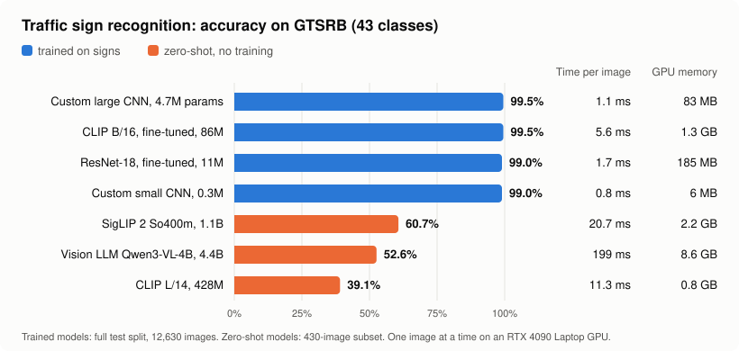

# Can a large general-purpose model replace a small specialised one? Traffic signs, measured

**Short answer: no.** On a narrow task with labelled data, a 4.7M-parameter CNN trained from scratch in three and a half minutes beats every large model we tried as is, and matches the best of them after fine-tuning at a fraction of the cost.

We asked the question in the three ways a large model can be used:

| How the model is used | Model | Parameters | Accuracy | Time per image | GPU memory |
|---|---|---|---|---|---|
| **Specialised, trained from scratch** | Custom CNN | **4.7M** | **99.5%** | **1.1 ms** | **83 MB** |
| Large, as is (zero-shot) | SigLIP 2 So400m | 1,136M | 60.7% | 20.7 ms | 2.2 GB |
| Large, as is (zero-shot) | Vision LLM, Qwen3-VL-4B | 4,438M | 52.6% | 199 ms | 8.6 GB |
| Large, as is (zero-shot) | CLIP L/14 | 428M | 39.1% | 11.3 ms | 0.8 GB |
| Pretrained features frozen, linear head trained | DINOv3-S | 21.6M | 65.7% | 10.0 ms | 93 MB |
| Large, fully fine-tuned on the same data | CLIP B/16 | 85.8M | 99.5% | 5.6 ms | 1.3 GB |

Zero-shot rows are measured on a 430-image balanced subset, where the custom CNN scores 98.8%; the other rows on the full GTSRB test split of 12,630 images.

- **As is, large models are not close.** The best one is 38 points behind while having 240 times more parameters. The vision LLM has 940 times more parameters, is 180 times slower and gets every second image wrong.
- **General-purpose features are not enough either.** With the backbone frozen and only a linear layer trained, DINOv2 and DINOv3 stop at 66%.
- **Fine-tuned, a large model only ties.** CLIP B/16 makes 63 errors on 12,630 images, the custom CNN 62. For that tie it needs 18 times more parameters, 5 times more time per image and 16 times more GPU memory. And once fine-tuned it is itself a specialised model that needs the same labelled data.

The second half of the study teaches the small network to answer "unknown" instead of guessing, which a plain classifier cannot do.

This repository contains the code, the raw results and a trained model, so every number below can be reproduced.



- [Try the trained model](#try-the-trained-model)
- [What we did and what we found](#what-we-did-and-what-we-found)
- [Technical details](#technical-details)
- [Reproduce the results](#reproduce-the-results)
- [Repository layout](#repository-layout)
- [Datasets](#datasets)

The full write-up with methodology, every table and all caveats is in [REPORT.md](REPORT.md).

## Try the trained model

The final model ships with the repository (`models/big_cnn_oe_all.pt`, 18 MB). It needs only PyTorch and runs on a CPU.

```bash
pip install torch torchvision pillow
```

```bash
python predict.py path/to/sign.png
```

The input is a photo of one sign cropped from the frame with a small margin, as in GTSRB. The script does not search for signs in a full frame. The answer is one of 43 sign names or `unknown`, with the confidence:

```text
data/testset/images/14_00251.png: Stop (class 14), confidence 1.0000
data/belgium_unknown/test/images/be27_00330_00001.png: unknown, confidence 0.0000
```

`--keep` sets how strict the model is. It is the share of clean held-out German signs the model accepts: `0.99`, `0.97` (default), `0.95` or `0.9`. Lower means fewer false answers and more rejections; the "zero false answers" table below uses `--keep 0.95`.

To get sample images, build the test set (downloads 89 MB):

```bash
python scripts/make_testset.py
```

## What we did and what we found

The task is the same everywhere: the input is a cropped photo of one sign, the output is one of the 43 classes of the German benchmark [GTSRB](https://benchmark.ini.rub.de/gtsrb_news.html). Detecting signs in a frame is out of scope. Everything ran on a laptop with an RTX 4090 Laptop GPU.

### Step 1. Is training needed at all?

We first checked whether ready-made models can do the job when given only the sign names and no labelled examples, and compared them with a plain ResNet-18 fine-tuned on signs.

CLIP and SigLIP 2 embed the image and 43 text prompts of the form `a photo of a '<sign name>' traffic sign` into one space and pick the closest prompt by cosine similarity:

```math
\hat{y}(x) = \arg\max_{k \in \{1..43\}} \frac{E_{img}(x) \cdot E_{txt}(t_k)}{\lVert E_{img}(x) \rVert \, \lVert E_{txt}(t_k) \rVert}
```

The vision LLM gets the image, upscaled to at least 224 px on the short side, and the list of 43 names in the prompt, and writes the name of one option.

| Approach | Parameters | Trained on signs | Accuracy (430 images) | Time per image | GPU memory |
|---|---|---|---|---|---|
| ResNet-18 classifier | 11.2M | yes, half a minute | 97.2–99.5% | 1.7 ms | 0.2 GB |
| SigLIP 2 So400m | 1,136M | no | 60.7% | 20.7 ms | 2.2 GB |
| Vision LLM, Qwen3-VL-4B | 4,438M | no | 52.6% | 199 ms | 8.6 GB |
| CLIP L/14 | 428M | no | 39.1% | 11.3 ms | 0.8 GB |

With 430 images the 95% interval of a 60% score is about ±4.6 points, so the order of the zero-shot models among themselves is less certain than their distance from the classifier.

The best zero-shot model gets four images out of ten wrong. These models confuse left and right, fail on crossed-out signs and degrade badly on small images: on signs up to 35 pixels wide all three score 27–38%. The vision LLM is the most expensive option and not the most accurate one.

### Step 2. Which classifier?

Next we compared 21 trainable classifiers on the full test split of 12,630 images, from a custom network with 0.3M parameters to ViT-B with 86M.

| Model | Parameters | Input | Accuracy | Errors of 12,630 | Time per image | GPU memory | Training |
|---|---|---|---|---|---|---|---|
| Custom large CNN, from scratch | 4.7M | 64 px | 99.51% | 62 | 1.1 ms | 83 MB | 3.4 min |
| CLIP B/16, fine-tuned | 85.8M | 224 px | 99.50% | 63 | 5.6 ms | 1,319 MB | 9.1 min |
| FastViT-T8 | 3.3M | 224 px | 99.31% | 87 | 6.2 ms | 61 MB | 4.4 min |
| ViT-B/16 | 85.8M | 224 px | 99.30% | 88 | 6.3 ms | 1,319 MB | 9.1 min |
| SigLIP 2 B/16, fine-tuned | 92.9M | 224 px | 99.29% | 90 | 6.1 ms | 1,429 MB | 9.7 min |
| DINOv2-S, fully fine-tuned | 21.7M | 224 px | 99.25% | 95 | 5.8 ms | 337 MB | 5.0 min |
| ResNet-18, mean of 4 runs | 11.2M | 96 px | 99.02% | 124 | 1.7 ms | 185 MB | 0.5 min |
| Custom small CNN, from scratch | 0.3M | 48 px | 98.99% | 127 | 0.8 ms | 6 MB | 0.5 min |
| DINOv3-S, linear head only | 21.6M | 224 px | 65.69% | 4,333 | 10.0 ms | 93 MB | 1.9 min |
| DINOv2-S, linear head only | 21.7M | 224 px | 65.60% | 4,345 | 4.1 ms | 88 MB | 1.9 min |

The full table of 22 rows is in [results/classifiers.md](results/classifiers.md).

- **Accuracy tops out at 99.0–99.5%.** Eight variants land in this band.
- **Differences inside the band are noise.** There are two sources of it. The sampling error of an accuracy measured on $`n`$ images is

  ```math
  SE = \sqrt{\frac{p(1-p)}{n}} = \sqrt{\frac{0.995 \cdot 0.005}{12630}} \approx 0.06 \text{ points,}
  ```

  a 95% interval of ±0.12 points. The run-to-run spread is larger: the same ResNet-18 training repeated with four seeds gave 98.8% to 99.3%, a standard deviation of 0.24 points. Models closer than about half a point cannot be ranked from one run.
- **Frozen general-purpose features give 66%.** A linear layer on top of frozen DINOv2 or DINOv3 features stops at 66%; the same DINOv2 backbone fine-tuned end to end reaches 99.25%. The pretrained representation does not contain the task; the training on signs does the work.
- **Large models pay several times over for fractions of a percent.** Fine-tuned CLIP B/16 is 3 times slower than ResNet-18 and uses 7 times more GPU memory.
- **Pretraining turned out to be optional.** A custom small network trained from scratch reached 99.0% with 6 MB of GPU memory and 0.8 ms per image.

We then scaled the custom network up to 4.7M parameters. It gives 99.42–99.51% in four runs (standard deviation 0.04 points), the same as the best large model, at 1.1 ms per image and 83 MB of GPU memory. Against fine-tuned CLIP B/16 that is 18 times fewer parameters, 5 times less time per image, 16 times less GPU memory at inference and 13 times less during training (0.7 GB against 9.8 GB).

### Step 3. What happens on signs from another country?

Models trained on German signs were tested on 940 Belgian images ([BelgiumTSC](https://btsd.ethz.ch/shareddata/)) shot with a different camera, without any further training.

| Model | Germany | Belgium |
|---|---|---|
| CLIP B/16, fine-tuned | 99.5% | 98.2% |
| Custom large CNN | 99.5% | 96.9% |
| Custom small CNN | 99.0% | 94.9% |
| ResNet-18 | 99.0% | 94.8% |
| SigLIP 2 So400m, zero-shot | n/a | 75.4% |

Every model loses accuracy: the best ones 1–4 points, lightweight mobile networks up to 11. Most of the loss comes from signs that are drawn differently in Belgium, not from the camera: "Children crossing" is recognised 72% of the time and "Bicycles crossing" 7%, while signs with identical artwork transfer at 98–100%. The custom CNN and ResNet-18 rows are means of four runs; the large CNN ranged from 95.3% to 97.8% (standard deviation 1.1 points), and the sampling error on 940 images adds a 95% interval of about ±1.1 points. CLIP was trained once, so this table cannot separate it from the custom large CNN. If large-scale pretraining helps anywhere in this study, it is here, on a shifted distribution; the data are not enough to say that it does.

### Step 4. A model that can say "unknown"

A plain classifier must pick one of 43 classes even when the sign is blurred, unfamiliar, or not a sign at all. We trained a single network to answer either with a sign or with "unknown" by adding a 44th output and a confidence threshold.

The network outputs 44 logits $`z`$: 43 signs plus "unknown". Its confidence is the largest probability among the 43 sign classes, with the softmax taken over all 44 outputs, so probability mass given to "unknown" lowers it:

```math
p_k(x) = \frac{e^{z_k(x)}}{\sum_{j=1}^{44} e^{z_j(x)}}, \qquad s(x) = \max_{k \le 43} p_k(x), \qquad
\text{answer}(x) = \begin{cases} \arg\max_{k \le 43} p_k(x) & \text{if } s(x) \ge \tau \\ \text{unknown} & \text{otherwise} \end{cases}
```

The threshold $`\tau`$ is never tuned on test data. It is the empirical $`(1-q)`$ quantile of $`s`$ on 2,070 held-out German images, so that the model accepts a share $`q`$ of them; `--keep` is $`q`$. The held-out images are whole tracks (every tenth physical sign), because frames of one track are near-duplicates and a random split would make the threshold too lenient.

Every image then falls into one of three outcomes, and their shares sum to one: answered correctly, answered falsely, rejected. For a set without known signs every answer is false.

What mattered most was what the network was shown as "unknown":

- **A confidence threshold alone** lets foreign signs through. ResNet-18 confidently names one in five of them as a known sign.
- **Only foreign Belgian signs** in training make the network reject every Belgian photo, known signs included. Belgian photos of known signs had to go into training too.
- **Road-scene crops without signs** in training remove false answers on background and also on random objects the network never saw.
- **All foreign sign types** in training remove the last confident errors. Before that the network took a "3.5 t weight limit" sign for "Speed limit 30", because it had never seen one.

The final model at the strict threshold (`--keep 0.95`):

| Test set | Correct | False answers | Rejected |
|---|---|---|---|
| German test, 12,630 images | 90.3% | 4 images (0.03%) | 9.7% |
| Belgian signs of known classes, 940 | 96.1% | 0 | 3.9% |
| Foreign signs, 983 | n/a | 0 | 100% |
| Road background crops, 2,000 | n/a | 0 | 100% |
| Random objects, 2,000 | n/a | 0 | 100% |

Zero observed errors is not a zero error rate. By the rule of three, 0 errors in $`n`$ independent trials bounds the true rate by $`3/n`$ at 95% confidence: below 0.31% for foreign signs and 0.15% for background and objects.

The threshold trades coverage (the share of images answered) for selective risk (the share of false answers among those answered). On the German test:

| `--keep` | Threshold $`\tau`$ | Coverage | False answers | Selective risk |
|---|---|---|---|---|
| no threshold | 0 | 100% | 86 | 0.68% |
| 0.99 | 0.9953 | 97.3% | 28 | 0.23% |
| 0.97 (default) | 0.99984 | 94.2% | 18 | 0.15% |
| 0.95 | 0.99999 | 90.3% | 4 | 0.035% |
| 0.90 | ≈ 1 | 84.6% | 1 | 0.009% |

Giving up 10% of the images cuts the error rate among the answers about 20 times. The thresholds are extreme because a softmax classifier is overconfident: at `--keep 0.95` an answer is accepted only if the network leaves about 0.001% of probability to everything else.

Two attempts to remove the remaining errors failed. Looking at each image nine times with small distortions does nothing, because the network makes the same mistake on every view. Requiring two different networks to agree helps on unfamiliar input (2 false answers instead of 10 on foreign signs of unseen types) but not on blurred known signs, where both make the same mistake.

### Takeaways

- **Large general-purpose models did not replace the specialised one.** As is they are 38 points or more behind; with frozen features, 34 points; fully fine-tuned they tie at 5 times the latency and 16 times the memory.
- **With labelled data, use a small trained classifier.** Zero-shot models are fine for a prototype, not for production.
- **Model size buys almost nothing here.** A 4.7M-parameter network matches models almost 20 times larger. What matters is training on the task, not the size or the pretraining.
- **False answers are fixed with data, not with a threshold.** The network reliably rejects only what it was shown as "unknown" during training.
- **Some errors cannot be removed from a single image.** A blurred "60" does look like "80". The next lever is agreement across neighbouring video frames, which we did not test.

### What these results do not show

- **The largest model tested has 4.4B parameters and runs locally.** Frontier multimodal models behind an API were not tested. They may score higher zero-shot; their latency and cost per image are further from 1 ms, not closer.
- **The task has plenty of labelled data:** 26,640 training images for 43 classes. With a handful of examples per class the balance between pretrained and from-scratch models may be different.
- **Zero false answers on foreign signs was measured on sign types the network had seen** (in other photos). On a type that is in none of the sets it may be as confidently wrong as it was on "3.5 t".
- **The reject models were trained once each.** The number of false answers on the German test moved from 12 to 18 between two trainings of the same network, so 4 could as well be 8.
- **Background crops are random.** In a real system the classifier receives whatever a detector took for a sign: round objects, adverts, street lamps. Expect more false answers on those.
- **Only one foreign country was tested,** and its signs are close to the German ones.
- **Speed was measured on a GPU only.**

## Technical details

### The network

The custom CNN is a plain VGG-style stack, about ten lines of PyTorch (`small_cnn` in [bench/finetune.py](bench/finetune.py)). One block is

```text
Conv 3x3 -> BatchNorm -> ReLU -> Conv 3x3 -> BatchNorm -> ReLU -> MaxPool 2x2
```

and the network is several blocks, global average pooling, dropout 0.3 and one linear layer.

| | Small CNN | Large CNN |
|---|---|---|
| Input | 48×48 RGB | 64×64 RGB |
| Blocks and channels | 3: 32, 64, 128 | 4: 64, 128, 256, 512 |
| Feature map before global pooling | 6×6×128 | 4×4×512 |
| Parameters | 293,451 | 4,711,275 |
| Weights, float32 | 1.1 MB | 18 MB |
| Epochs | 15 | 30 |

In the large network 4,685,376 of the parameters are convolution weights, 3,840 belong to batch norm and 22,059 to the linear layer; the "unknown" output adds 513 more. The receptive field of its last convolution is 68 px, so every output feature sees the whole 64 px image. There are no residual connections, attention layers or pretrained weights.

### Training

All classifiers share one recipe; only the learning rate, input size and number of epochs differ.

- **Loss:** cross-entropy over 43 classes (44 with "unknown"), no label smoothing, no class weights:

  ```math
  L = -\frac{1}{B} \sum_{i=1}^{B} \log p_{y_i}(x_i), \qquad B = 128
  ```

- **Optimiser:** AdamW, weight decay $`10^{-4}`$, one-cycle learning-rate schedule. Peak rate $`2 \cdot 10^{-3}`$ for the custom CNNs and from $`3 \cdot 10^{-5}`$ to $`10^{-3}`$ for pretrained models, chosen by model family (see `MODELS` in [bench/finetune.py](bench/finetune.py)).
- **Epochs:** 6 for pretrained models, 15 and 30 for the custom CNNs trained from scratch.
- **Precision:** bfloat16 autocast during training, float32 at inference.
- **Augmentation:** rotation up to ±10°, shift up to 10%, scale 0.9–1.1, brightness and contrast ±40%, saturation ±30%. No mirror flips: they turn "keep right" into "keep left".
- **Input:** the crop is resized to a square without preserving the aspect ratio. Custom CNNs normalise with mean and standard deviation 0.5; pretrained models use their own statistics.
- **Data:** GTSRB train, 26,640 images, 43 classes.

The final model is trained on 43,734 images, of which 28% are "unknown":

| Source | Label | Images | Repeats | In training |
|---|---|---|---|---|
| GTSRB train without held-out tracks | 43 signs | 24,570 | 1 | 24,570 |
| BelgiumTSC, signs of known classes | 43 signs | 1,773 | 4 | 7,092 |
| BelgiumTSC, foreign sign types, group A | unknown | 868 | 4 | 3,472 |
| BelgiumTSC, foreign sign types, group B | unknown | 1,150 | 4 | 4,600 |
| GTSDB road crops without signs | unknown | 4,000 | 1 | 4,000 |

Scarce sources are repeated four times per epoch, with different augmentations each time. Random objects (CIFAR-100) are never used in training, only in evaluation.

### Measurement

- **Time per image** is wall-clock time for one image at a time (batch size 1) on the GPU, including reading the file, resizing and normalising, after a warm-up. It is the latency a single request would see, not the throughput of batched inference.
- **GPU memory** is the peak allocated by PyTorch during inference: weights plus activations.
- **Zero-shot models** run in float16, the vision LLM in bfloat16, the classifiers in float32.
- **Accuracy** of the classifiers is measured on the full GTSRB test split (12,630 images). The zero-shot models are measured on a balanced subset of 430 images, 10 per class.
- **Hardware:** one RTX 4090 Laptop GPU with 16 GB of memory.

## Reproduce the results

Parts 1–4 need Linux with an NVIDIA GPU: 16 GB of GPU memory covers everything, and 4 GB is enough for the custom CNNs and ResNet-18. The scripts use CUDA directly and do not run on CPU or Apple Silicon. Tested with Python 3.14, PyTorch 2.15 (CUDA 13.2), torchvision 0.29 and transformers 5.24.

The raw results of our runs are already in `results/`. Each run script overwrites them and regenerates its table; set `SKIP_DONE=1` to keep results that exist. A fresh copy of this repository reproduced the shipped numbers exactly on the same machine. On other GPUs or library versions expect small differences: training is seeded but not bit-exact across setups, and accuracy moves by about 0.5 points between runs on the German test and up to 2.5 on the Belgian one.

### 1. Set up

```bash
git clone <this repository> && cd <its folder>
```

```bash
bash setup.sh
```

`setup.sh` creates `.venv` and installs `requirements.txt`.

### 2. Prepare the data

All datasets are downloaded by the scripts; nothing has to be fetched by hand.

| Command | Downloads | Builds | Needed for |
|---|---|---|---|
| `.venv/bin/python scripts/make_testset.py` | GTSRB test, 89 MB | `data/testset/`, 430 images | all parts |
| `.venv/bin/python scripts/make_belgium.py` | BelgiumTSC, 252 MB | `data/belgium/`, `data/belgium_train/` | parts 3 and 4 |
| `.venv/bin/python scripts/make_belgium_unknown.py` | nothing | `data/belgium_unknown/` | part 4 |
| `.venv/bin/python scripts/make_background.py` | GTSDB 1.1 GB, CIFAR-100 170 MB | `data/background/` | part 4 |

The GTSRB training split (about 190 MB) is downloaded by torchvision on the first training run.

### 3. Run

| Part | Command | What it does | Rough time on an RTX 4090 Laptop |
|---|---|---|---|
| 1 | `bash run_part1_baselines.sh` | CLIP, SigLIP 2, Qwen3-VL-4B and ResNet-18 on 430 images | 10 min, plus about 12 GB of model downloads |
| 2 | `bash run_part2_classifiers.sh` | fine-tunes and measures 22 classifiers | 1.5 h |
| 3 | `bash run_part3_transfer.sh` | retrains them and tests on Belgian signs | 2 h |
| 4 | `bash run_part4_reject.sh` | trains every reject variant, checks agreement rules | 40 min |

Each script accepts model names to run a subset. The fastest way to check the headline numbers:

```bash
bash run_part2_classifiers.sh big_cnn small_cnn resnet18_tv
```

```bash
bash run_part4_reject.sh final
```

The first command trains the custom CNNs and ResNet-18 in about 5 minutes. The second retrains the shipped model in about 6 minutes, prints its numbers for every threshold and overwrites `models/big_cnn_oe_all.pt`.

### 4. Read the tables

| Part | Table | Raw results |
|---|---|---|
| 1 | [results/report.md](results/report.md) | `results/*.json` |
| 2 | [results/classifiers.md](results/classifiers.md) | `results/classifiers/*.json` |
| 3 | [results/transfer.md](results/transfer.md) | `results/transfer/*.json` |
| 4 | [results/reject.md](results/reject.md) | `results/reject/*.json`, `results/agree_*.json`, `results/tta.json` |

The tables are rebuilt from the JSON files by `bench/report*.py`, which need only the Python standard library. The JSON files hold the answer for every image, so any number can be recomputed without a GPU.

## Repository layout

```text
predict.py                 recognise a sign in an image, or answer "unknown"
models/big_cnn_oe_all.pt   the final model
setup.sh, requirements.txt environment
run_part1..4_*.sh          one script per part of the study
scripts/                   dataset preparation (downloads included)
bench/zeroshot.py, vlm.py  zero-shot CLIP / SigLIP 2 and the vision LLM
bench/classifier.py        the ResNet-18 reference of part 1
bench/finetune.py          all classifiers of parts 2 and 3, including the custom CNNs
bench/reject.py            classifier with a reject option, part 4
bench/agree.py, tta.py     two-model and multi-view agreement
bench/report*.py           build the tables in results/*.md
bench/chart.py             draws docs/accuracy.svg
results/                   raw results and tables of our runs
REPORT.md                  full write-up
```

## Datasets

The datasets are not redistributed here; the scripts download them from their official sources. Check their terms before using them for anything beyond research.

- **GTSRB**, German Traffic Sign Recognition Benchmark: Stallkamp et al., 2012. Training and test images of 43 classes.
- **GTSDB**, German Traffic Sign Detection Benchmark: Houben et al., 2013. Full road frames, used here as a source of background crops.
- **BelgiumTSC**: Timofte, Zimmermann and Van Gool, 2014. Belgian signs, used as the other-country test and as "unknown" signs.
- **CIFAR-100**: Krizhevsky, 2009. Used as random non-sign objects.

`models/big_cnn_oe_all.pt` was trained on GTSRB, BelgiumTSC and GTSDB crops.

## License

The code is released under the MIT license, see [LICENSE](LICENSE).
